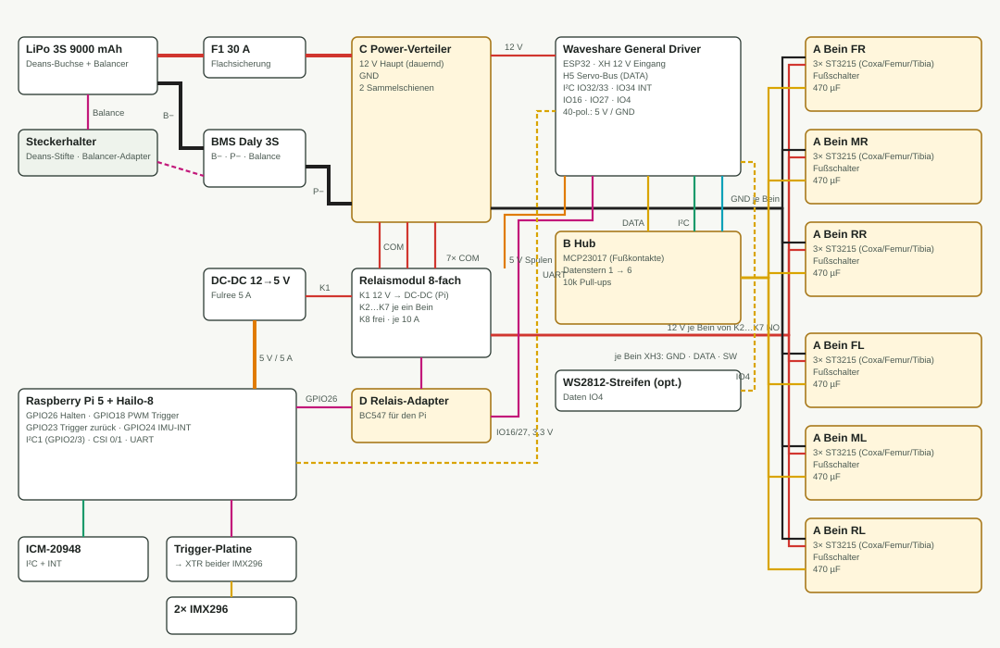
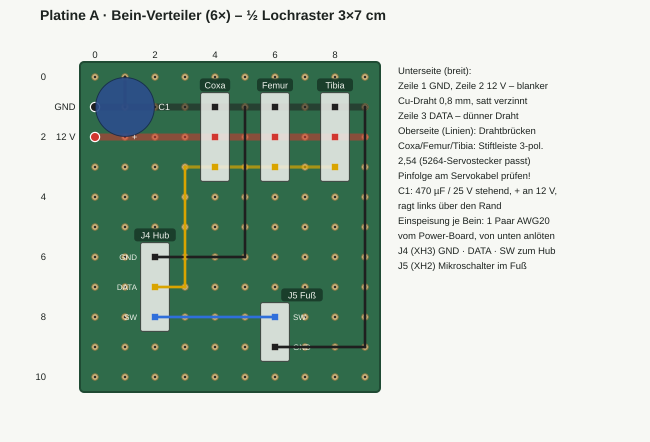
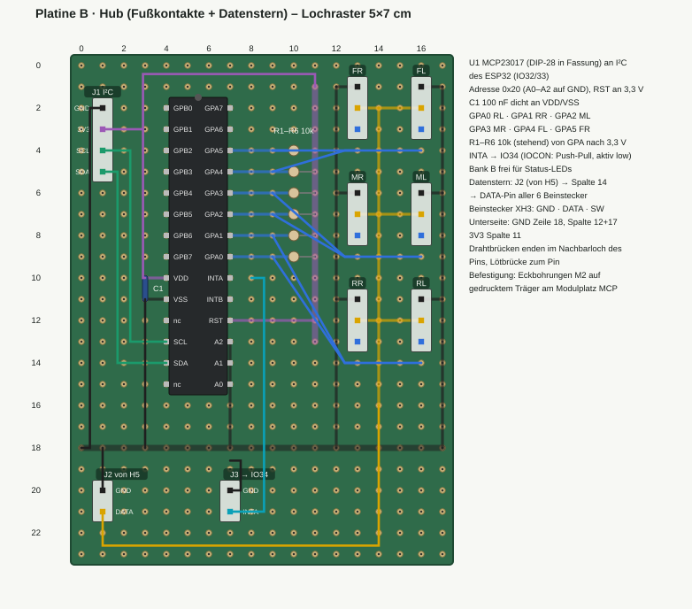
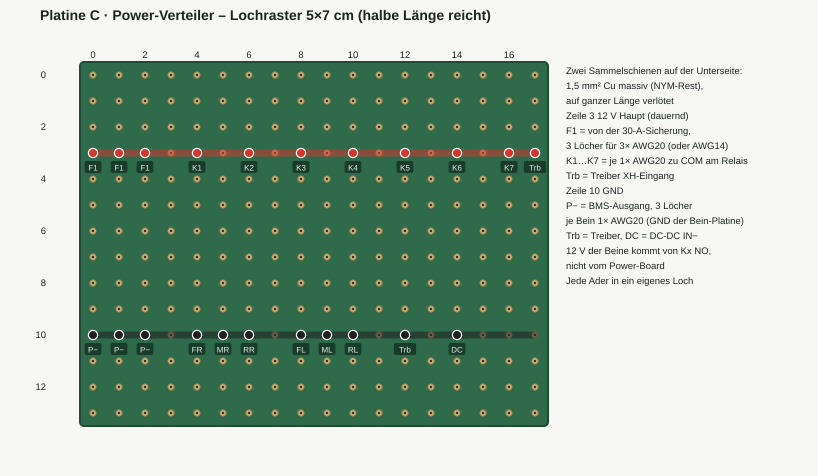
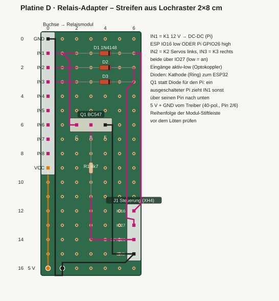

# SLARC – Verkabelung

Stand 25.10.2026. Plan für Energie, Servo-Bus, Fußkontakte, Relais und Sensorik, dazu vier Lochraster-Platinen zum Selberbauen. Die Layouts sind für die AZ-Delivery-Lochrasterplatinen (2,54 mm, durchkontaktiert) gezeichnet. Die SVGs erzeugt `gen_wiring_svg.py` (`python gen_wiring_svg.py . file`).

## Grundentscheidungen

- **Akku → BMS → Verteiler.** Akku-Plus über die 30-A-Flachsicherung F1 auf das Power-Board (Platine C). Akku-Minus auf B− des Daly-BMS, dessen P− auf die GND-Schiene. Der Balancer hängt über den Adapter im Steckerhalter am BMS. Geladen wird extern, der Akku kommt dafür raus.

- **Drei Relais, alle vom ESP32 gesteuert.**
  - K1 schaltet 12 V auf den DC-DC-Wandler, also den Pi.
  - K2 schaltet die Servos links, K3 die Servos rechts.
  - Der ESP32 läuft dauernd, sobald der Akku steckt. Er entscheidet, wann Pi und Servos Strom bekommen, und kann den Servos im Notfall die Spannung nehmen, ohne auf den Bus angewiesen zu sein.
  - Der Pi hält K1 zusätzlich selbst über einen Transistor, damit er sauber herunterfahren kann.

- **Servo-Strom sternförmig.** Jede Bein-Platine (A) bekommt ein eigenes Paar AWG20 vom Power-Board. Auf der Bein-Platine geht jeder Servo einzeln ab, ohne Daisy-Chain durch die Servos. So fließt durch die dünnen Servokabel nur der Strom eines Servos.

- **Daten getrennt vom Strom.** Am Treiber wird von H5 nur DATA und GND abgegriffen. Auf dem Hub (B) verteilt sich DATA sternförmig auf die sechs Beine. H5 und H6 hängen auf dem Treiber ohnehin am selben Bustreiber (SN74LVC1G125), deshalb genügt H5. GND läuft in jedem Signalkabel mit. So hat DATA eine saubere Masse, auch wenn auf den Stromleitungen bei 15 A ein paar Zehntel Volt abfallen.

- **Fußkontakte am MCP23017 auf dem Hub.** Jeder Fußschalter läuft mit zwei Adern das Bein hoch zur Bein-Platine. Von dort geht er im 3-adrigen Signalkabel (GND · DATA · SW) zum Hub. Dort sitzt ein 10-kΩ-Pull-up nach 3,3 V.

- **Pi-Versorgung kurz und doppelt.** Vom DC-DC-Ausgang laufen je Pol 2× AWG20 zum Pi. Das geht über die USB-C-Buchse oder über die 5-V-Pins der GPIO-Leiste.

- **Strommessung am Treiber.** Das INA219 auf dem Treiber misst nur noch den Strom des Treibers. Die Akkuspannung sieht es weiterhin.

## Strombudget und Querschnitte

| Verbraucher | Mittel | Spitze | Leitung |
|---|---|---|---|
| 18 Servos gesamt (Tripod) | ~10 A | 20–30 A | – |
| je Seite (9 Servos, über K2/K3) | ~5 A | ~15 A | Power-Board ↔ Relais: 2× AWG20 je Weg |
| je Bein (3 Servos) | ~1,7 A | 8,1 A (3× 2,7 A Stall) | 1 Paar AWG20, 15–30 cm |
| Pi 5 + Hailo-8 (5 V) | 2–3 A | ~5 A | je Pol 2× AWG20, ≤ 25 cm (≈ 40 mV Abfall) |
| DC-DC-Eingang (12 V, über K1) | ~1,3 A | ~2,5 A | AWG20 |
| Treiber (12 V) | 0,15 A | 0,5 A | mitgeliefertes XH-Kabel oder AWG22 |
| Relaisspulen (5 V vom Treiber) | 3× 72 mA | – | AWG24 |
| Akku → F1 → Power-Board, Akku− → BMS → GND | ~12 A | 30 A | **AWG14** (oder 3× AWG20 parallel), ≤ 30 cm |

Laufzeit grob: 9 Ah bei ~12 A Mittel ergibt 40–45 min Gehen.

Kurzschlussschutz: Ein Kurzschluss löst die Kurzschlussabschaltung des BMS im Mikrosekundenbereich aus, F1 sichert dahinter. Die kurzen AWG20-Abgänge brauchen deshalb keine eigene Sicherung.

**AWG20 und Steckverbinder.** Für Datenleitungen ist AWG20 elektrisch mehr als genug. Es passt aber nicht in XH- oder Dupont-Crimpkontakte, die nehmen höchstens AWG22. Deshalb gilt:

- Gelötete Verbindungen und alle Stromleitungen: AWG20.

- Gesteckte Signalleitungen (Hub ↔ Beine, I²C, INT, Relais): AWG24.

## Leitungsliste

| Nr | Von | Nach | Adern | Querschnitt | Verbindung |
|---|---|---|---|---|---|
| L1 | Deans + (Steckerhalter) | F1 → Power-Board 12 V Haupt | 1 | AWG14 | gelötet / Flachsicherungshalter |
| L2 | Deans − | BMS B− | 1 | AWG14 (BMS-Litze) | gelötet |
| L3 | BMS P− | Power-Board GND | 1 | AWG14 | gelötet, 3 Löcher |
| L4 | Balancer-Adapter (Steckerhalter) | BMS Balance | 4 | BMS-Kabel | Stecker; erst B−, dann Balancer |
| L5 | Power-Board 12 V Haupt | K1 / K2 / K3 COM | 1 / 2 / 2 | AWG20 | Schraubklemme Relais |
| L6 | K2 NO / K3 NO | Power-Board 12 V links / rechts | je 2 | AWG20 | Schraubklemme |
| L7 | Power-Board 12 V links/rechts + GND | Bein-Platine je Bein | 2 | AWG20 | beidseitig gelötet |
| L8 | K1 NO / Power-Board GND | DC-DC IN+ / IN− | 2 | AWG20 | gelötet |
| L9 | DC-DC OUT+ / OUT− | Pi 5 (USB-C-Pigtail oder Pin 2+4 / 6+9) | 2 + 2 | AWG20 | gelötet / Dupont |
| L10 | Power-Board 12 V Haupt + GND | Treiber XH-Eingang | 2 | AWG20 / XH-Kabel | XH2 |
| L11 | Treiber H5 (DATA, GND) | Hub J2 | 2 | Servokabel 5264 | 5264 / XH2 |
| L12 | Treiber I²C (GND, 3V3, SCL, SDA) | Hub J1 | 4 | AWG24 | XH4 |
| L13 | Hub J3 INTA | Treiber IO34 | 2 (INT, GND) | AWG24 | Encoder-Stecker A |
| L14 | Hub J-FR … J-RL | Bein-Platine J4 | 3 je Bein | AWG24 | XH3 / XH3 |
| L15 | Fußschalter | Bein-Platine J5 | 2 | AWG24 | im Bein geführt, XH2 |
| L16 | Femur-/Tibia-/Coxa-Servo | Bein-Platine | 3 je Servo | Servokabel | 5264 auf Stiftleiste |
| L17 | Treiber IO16, IO27, GND | Relais-Adapter J1 | 3 | AWG24 | XH4 |
| L18 | Pi GPIO26 (Pin 37) | Relais-Adapter J1 | 1 | AWG24 | Dupont / XH4 |
| L19 | Treiber 40-pol. 5 V (Pin 2) / GND (Pin 6) | Relais-Adapter 5 V / GND | 2 | AWG24 | Dupont / gelötet |
| L20 | Treiber IO4 + 5 V + GND | WS2812-Streifen (optional) | 3 | AWG24 | 3-pol. Servostecker |
| L21 | Pi I²C1 (Pin 1, 3, 5, 9) + GPIO24 (Pin 18) | ICM-20948 | 5 | AWG24 | Dupont |
| L22 | Pi GPIO18 (Pin 12) / GPIO23 (Pin 16) | Trigger-Platine (Ausgang / Rückführung) | 2 + GND | Dupont | Dupont |
| L23 | Pi CAM0 / CAM1 | IMX296 links / rechts | FPC | – | CSI-Kabel 200 mm |
| L24 | Pi ↔ ESP32 | UART | 3 oder USB | AWG24 / USB-C | USB-C (CP2102) oder GPIO14/15 an die 40-pol. Leiste |

## Pinbelegung

**ESP32 (Waveshare General Driver)**

| Pin | Funktion | Richtung |
|---|---|---|
| IO18 / IO19 | Servo-Bus (UART1, intern über SN74LVC1G125/126) | – |
| IO32 / IO33 | I²C: Board-IMU QMI8658C/AK09918C + MCP23017 (0x20) | – |
| IO34 | MCP23017 INTA | Eingang |
| IO16 | K1 Pi-Versorgung, **low = an** | Ausgang |
| IO27 | K2 + K3 Servo-Versorgung, **low = an** | Ausgang |
| IO4 | WS2812-Daten | Ausgang |
| IO35 | frei (nur Eingang) | – |
| IO5 | frei (Strapping-Pin, beim Booten nicht low ziehen) | – |

**Raspberry Pi 5**

| GPIO (Pin) | Funktion |
|---|---|
| GPIO2 / GPIO3 (3 / 5) | I²C1 → ICM-20948 |
| GPIO24 (18) | ICM-20948 INT |
| GPIO18 (12) | PWM Kameratrigger (wie im Trigger-Setup; mit `config.txt` abgleichen) |
| GPIO23 (16) | Trigger-Rückführung (Zeitstempel) |
| GPIO26 (37) | K1 halten, **high = halten** |
| GPIO14 / GPIO15 (8 / 10) | UART zum ESP32, falls nicht über USB |
| 5 V (2, 4), GND (6, 9) | Versorgung, wenn nicht über USB-C |

Bei Versorgung über die GPIO-5-V-Pins oder ein Netzteil ohne USB-PD: `PSU_MAX_CURRENT=5000` in der EEPROM-Konfiguration setzen (`sudo rpi-eeprom-config -e`). Sonst begrenzt der Pi die USB-Ports und warnt.

**MCP23017 (Hub):** GPA0 = RL, GPA1 = RR, GPA2 = ML, GPA3 = MR, GPA4 = FL, GPA5 = FR. Die Reihenfolge folgt der Leiterführung auf der Platine, die Firmware bildet sie auf die Beine ab. Bank B ist frei für Status-LEDs. Jede LED braucht einen 330-Ω-Vorwiderstand, insgesamt höchstens ~125 mA.

## Platinen

Allgemein:

- **Unterseite:** Schienen aus Draht, satt verzinnt. Sie sind breit und halbtransparent gezeichnet.

- **Oberseite:** Drahtbrücken, als farbige Linien gezeichnet. Jede Drahtbrücke endet im Nachbarloch des Pins und wird dort mit einer Lötbrücke angeschlossen.

- **Farben:** rot 12 V, schwarz GND, gelb DATA, blau Fußschalter, grün I²C, lila 3,3 V, orange 5 V, magenta Relaissteuerung, türkis INT.

- **Vor dem Löten prüfen:**
  - die Pinfolge am Servokabel (GND / 12 V / DATA)
  - an H5, welcher Pin DATA ist: Er liegt im Ruhezustand bei 3,3–5 V, der Versorgungspin bei Akkuspannung.
  - die Reihenfolge der Eingangsleiste am Relaismodul

### A – Bein-Verteiler (6×)

Eine halbe 3×7-cm-Platine (10 × 11 Löcher), aus jeder 3×7 entstehen zwei Bein-Platinen.

- **Bestückung:** drei 3-polige Stiftleisten für Coxa, Femur und Tibia, C1 470 µF / 25 V, XH3 J4 zum Hub, XH2 J5 für den Fußschalter.

- **Einspeisung:** 12 V und GND von unten direkt an die Schienen löten.

- **Montage:** dicht am jeweiligen Coxa-Servo zwischen den Platten. Die genaue Lage prüfe ich im CAD, sobald die Platinen gebaut sind.

### B – Hub (1×)

5×7 cm.

- **U1:** MCP23017 im DIP-28-Gehäuse in Fassung. A0–A2 auf GND, das ergibt Adresse 0x20. RESET an 3,3 V. C1 100 nF dicht an VDD/VSS.

- **Pull-ups:** sechs 10-kΩ-Widerstände, stehend, von GPA0–5 nach 3,3 V.

- **Datenstern:** Spalte 14 auf der Unterseite verbindet J2 (von H5) mit den DATA-Pins aller sechs Beinstecker.

- **Montage:** auf dem Modulplatz MCP (−115 / +35). Dafür kommt ein kleiner gedruckter Träger, der die M2-Eckbohrungen der Platine aufnimmt. Dafür fehlt noch das gemessene Eckloch-Maß.

- **Breakout statt DIP:** Steckt statt des DIP ein Breakout drauf, ändert sich nur die Lage von U1.

### C – Power-Verteiler (1×)

5×7 cm mit vier Sammelschienen auf der Unterseite aus 1,5 mm² Kupfer massiv, zum Beispiel ein Rest NYM-Leitung, auf ganzer Länge verlötet:

- 12 V Haupt (dauernd)

- 12 V links (hinter K2)

- 12 V rechts (hinter K3)

- GND

Jede Ader kommt in ein eigenes Loch. Platz: unter der oberen Platte über dem BMS, neben dem Relaismodul.

### D – Relais-Adapter (1×)

Ein Streifen aus der 2×8-cm-Platine. Er sitzt mit einer 10-poligen Buchsenleiste auf der Eingangsleiste des Relaismoduls. Die Modul-Eingänge sind aktiv-low, das Modul läuft mit VCC = JD-VCC = 5 V vom Treiber.

- **ESP32-Seite:** IO16 → D1 → IN1 und IO27 → D2/D3 → IN2/IN3. Der Ring der 1N4148 zeigt zum ESP32. Die Dioden sorgen dafür, dass ein 3,3-V-High den 5-V-Optokoppler sicher sperrt.

- **Pi-Seite:** GPIO26 → 4,7 kΩ → BC547 → IN1. Eine Diode geht hier nicht: Ein ausgeschalteter Pi zöge IN1 über die Schutzdiode seines Pins nach unten, und K1 würde einschalten.

## Ablauf Ein / Aus

1. Akku stecken: ESP32 und BMS laufen, DC-DC und Servos sind stromlos (K1–K3 aus).

2. ESP32 zieht IO16 low: K1 zieht an, der DC-DC startet, der Pi bootet (`POWER_OFF_ON_HALT=0` ist gesetzt).

3. Der Pi setzt GPIO26 high: K1 hält jetzt auch ohne den ESP32.

4. ESP32 zieht IO27 low: Die Servos bekommen Strom (Drehmoment vorher aus, dann einschalten).

5. Ausschalten: ESP32 nimmt die Servos weg (IO27 high). Der Pi fährt herunter, GPIO26 fällt ab, K1 fällt, sobald der ESP32 IO16 auch losgelassen hat.

Im Stand zieht der ESP32 samt Treiber Strom. Den Akku nach dem Betrieb abziehen.

## Inbetriebnahme

1. Jede Platine vor dem ersten Einschalten durchmessen: kein Durchgang zwischen 12 V und GND und zwischen 3,3 V und GND.

2. **Servo-IDs vergeben, bevor ein Servo an den Bus kommt.** Neue ST3215 haben alle ID 1. Jeden Servo einzeln am Treiber anschließen und umnummerieren, zum Beispiel FR 11/12/13 … RL 61/62/63.

3. Nur Treiber und Relais-Adapter: IO16 und IO27 toggeln, die Relais müssen hörbar klicken.

4. DC-DC an K1, am Ausgang 5,0–5,25 V messen, erst dann den Pi anschließen.

5. Hub: Im I²C-Scan des ESP32 erscheint 0x20. Jeden Fußschalter drücken und das passende GPA-Bit prüfen.

6. Ein Bein komplett, dann alle.

## Offen

- Lage der Bein-Platinen, des Power-Boards und des Relais-Adapters im CAD prüfen und Halter vorsehen.

- Träger für den Hub am Modulplatz MCP (Eckbohrungen der 5×7-Platine messen).

- Trigger-Platine (20 × 22 mm) ist eigenständig und hier nur verdrahtet.
